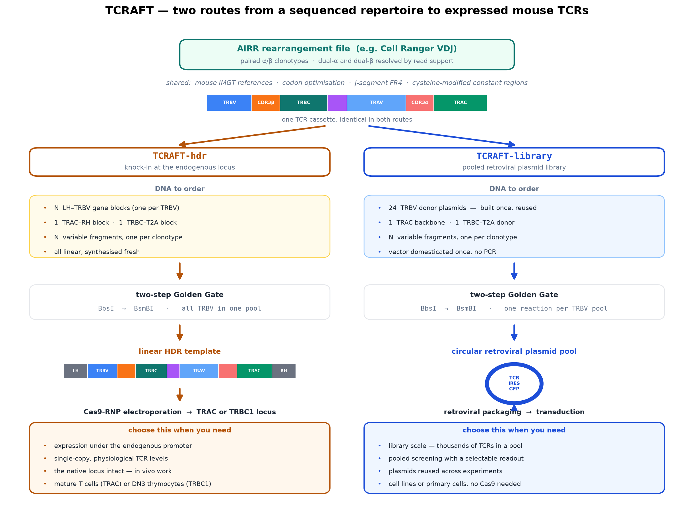
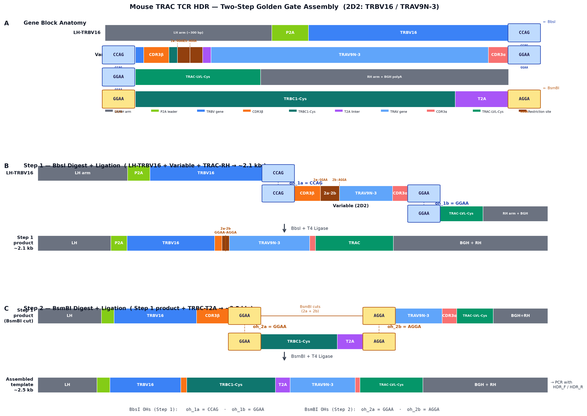
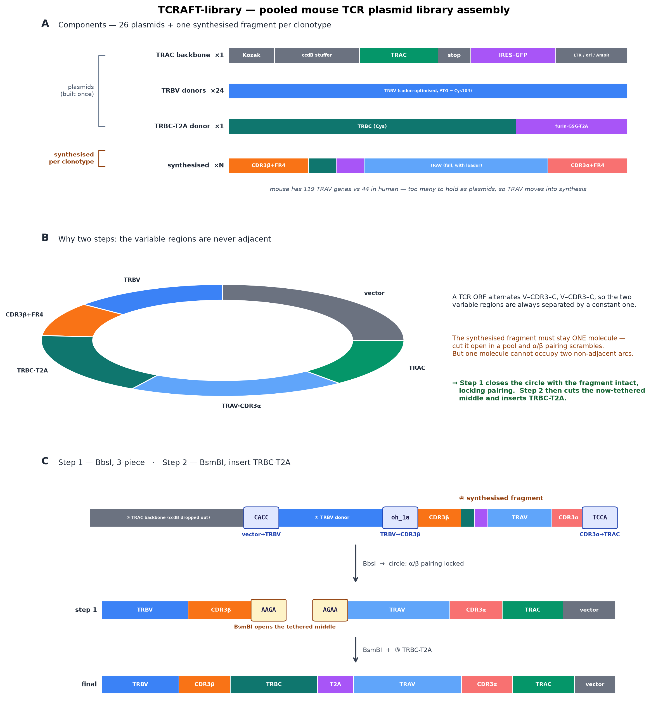

# TCRAFT — Mouse

TCRAFT is a scalable and cost-effective platform for TCR library assembly. This mouse-specific fork extends the original human TCRAFT package with a second pipeline: **TCRAFT-hdr**, which designs all DNA fragments required for Cas9-RNP mediated knock-in of a paired TCRαβ into an endogenous mouse TCR locus.

---

## Installation

Requires Python 3.9+ and [uv](https://docs.astral.sh/uv/).

```bash
git clone <repo>
cd TCRAFT_mouse
uv sync
```

This creates a virtual environment and installs all dependencies from `uv.lock`. To install in editable mode for development:

```bash
uv sync --editable
```

---



*Two routes from a sequenced repertoire to expressed mouse TCRs — both share the same cassette,
references and codon optimisation, and differ only in delivery. Regenerate with
`uv run python docs/make_graphical_abstract.py`.*

## Three pipelines

### 1. TCRAFT-generate (human CDR3 oligo pools)

Converts a CSV of TCR sequences into CDR3 oligonucleotide pools for the human TCRAFT golden gate assembly.

**Input:** CSV with columns `V_alpha`, `V_beta`, `J_alpha`, `J_beta`, `CDR3_alpha`, `CDR3_beta`

```bash
TCRAFT-generate /path/to/tcr_list.csv --output_dir ./output/
```
```python
from TCRAFT.Generate import generate_cdr3_oligos
generate_cdr3_oligos("tcr_list.csv", output_dir="./output/")
```

**Outputs:** oligo CSVs split by pool (A/B) and length (≤300 bp / >300 bp), metadata table, invalid TCR log.

**Validate assembled sequences:**
```bash
TCRAFT-validate /path/to/oligos.csv
```

---

### 2. TCRAFT-hdr (mouse TCR knock-in design)

Designs all gene blocks and per-TCR variable fragments for a two-step BbsI → BsmBI golden gate assembly that produces an HDR template for Cas9-RNP knock-in at an endogenous mouse TCR locus.



*(regenerate with `uv run python docs/make_assembly_figure.py`)*

Two target loci are supported:

| `--locus` | Target cells | Use when... |
|---|---|---|
| `TRAC` *(default)* | Mature T cells | Cells have already rearranged their TCR loci |
| `TRBC1` | DN3 double-negative thymocytes | Cells have **not** yet rearranged their TCRβ locus |

**Input:** AIRR-format rearrangement TSV (e.g., from Cell Ranger VDJ)

> **Changed in 1.4.0 — designs now include FR4.** IMGT's `junction_aa` stops at the conserved
> F/W at position 118, but the J segment continues past it with FR4: the final β-strand of the
> V domain, which connects it to the constant region. Earlier versions joined `junction_aa`
> straight to the constant region, dropping 9 aa on β and 10–11 aa on α. **Designs generated
> before 1.4.0 are missing FR4 and should be regenerated.** The per-gene FR4 table lives in
> `TCRAFT/references/mouse/mouse_J_FR4.csv`; rebuild it with
> `TCRAFT/scripts/build_j_fr4_table.py`. Clones whose J gene has no usable FR4 (IMGT
> pseudogenes) are reported in `invalid_clones.csv` rather than silently truncated.

> **Changed in 1.4.0 — chain pairing accounts for every input group.** `clone_id` groups
> *cells*, so a clone seen in 18 cells contributes 18 rows. The previous rule counted rows and
> required exactly one TRA and one TRB, which discarded multi-cell clones as "doublets" and
> dropped dual-α cells silently — they appeared in no output at all. Chains are now collapsed
> to distinct rearrangements first (summing read support), and a locus with two distinct
> chains is resolved to the dominant one by `consensus_count`; only groups ambiguous at *both*
> loci are treated as doublets. On the reference AIRR this takes designable clonotypes from
> 2,917 to 3,888, and every one of the 5,022 input groups is now accounted for in
> `invalid_clones.csv`. Pass `resolve_multi=False` to `pair_airr_records` for the strict rule.

#### TRAC locus (mature T cells — default)

```bash
TCRAFT-hdr airr_rearrangement.tsv --output_dir ./output/hdr_trac/
```
```python
from TCRAFT.HDR_Design import generate_hdr_design
result = generate_hdr_design("airr_rearrangement.tsv", output_dir="./output/hdr_trac/")
```

HDR template structure:
```
[TRAC-LH] [P2A] [TRBV] [CDR3β] [TRBC-Cys] [T2A] [TRAV] [CDR3α] [TRAC-LVL-Cys] [BGH polyA] [TRAC-RH]
```

The P2A self-cleaving peptide rides in-frame with the upstream TRAC open reading frame. The insert is expressed as part of a polyprotein that is cleaved co-translationally.

#### TRBC1 locus (DN3 thymocytes)

```bash
TCRAFT-hdr airr_rearrangement.tsv --locus TRBC1 --output_dir ./output/hdr_trbc1/
```
```python
result = generate_hdr_design("airr_rearrangement.tsv", locus='TRBC1', output_dir="./output/hdr_trbc1/")
```

HDR template structure:
```
[TRBC1-LH] [Kozak] [TRBV] [CDR3β] [TRBC-Cys] [T2A] [TRAV] [CDR3α] [TRAC-LVL-Cys] [BGH polyA] [TRBC1-RH]
```

A Kozak context sequence (`GCCGCCACC`) is placed immediately 5' of each TRBV's native ATG start codon. The cassette is expressed from the endogenous Vβ promoter/Eβ enhancer at the TRBC1 locus. The golden gate assembly scheme — and the variable fragment — are **identical** to the TRAC design; only the LH-TRBV gene blocks and the right homology arm in the TRAC-RH gene block change.

#### Restrict to a single TRBV gene (testing / specific experiments)

```bash
TCRAFT-hdr airr_rearrangement.tsv --trbv TRBV5 --output_dir ./output/
TCRAFT-hdr airr_rearrangement.tsv --locus TRBC1 --trbv TRBV5 --output_dir ./output/
```

#### Outputs

```
output/hdr_*/
├── constant_gene_blocks.csv   — LH-TRBV + TRAC-RH + TRBC-T2A fragments (order once per lab)
├── variable_gene_blocks.csv   — 1 variable fragment per TCR clone (order per experiment)
├── overhangs.json             — all OH sequences and NEB efficiency scores
├── assembly_report.txt        — locus, OH table, pool assignments, fragment sizes
├── invalid_clones.csv         — skipped clones with error reasons
└── gb/
    ├── constants/             — annotated .gb file per constant fragment
    └── clonotypes/
        └── <clone_id>/
            ├── variable.gb    — gene block with GG site annotations
            └── assembled.gb   — final HDR template, all regions annotated
```

The `assembled.gb` files can be opened directly in SnapGene, Benchling, or Geneious to visually verify the design before ordering.

#### Reaction pools

All TRBV-specific LH-TRBV fragments, variable fragments, TRBC-T2A, and TRAC-RH assemble in a single BbsI reaction (step 1), followed by a single BsmBI reaction (step 2) to insert TRBC-T2A. One TRBV gene (currently TRBV14) requires a separate BbsI reaction pool — this is flagged in `assembly_report.txt`.

See `TCR_HDR_DESIGN.md` for full specifications.

### 3. TCRAFT-library (mouse pooled TCR plasmid library)

Designs the same TCR cassette as a pooled plasmid library in the pMIGR retroviral vector,
for array-scale cloning rather than locus knock-in.

```bash
TCRAFT-library airr_rearrangement.tsv --output_dir ./output/library/
TCRAFT-library airr_rearrangement.tsv --stuffer ccdB.fa --trbv TRBV5
```



*(regenerate with `uv run python docs/make_library_figure.py`)*

Adapts the original human TCRAFT scheme to mouse. Human has 44 TRAV genes and keeps them in a
plasmid library; mouse has 119 in the IMGT reference, so TRAV moves out of the vector set and
into de novo synthesis. What remains as plasmids is the TRBV set, the TRBC-T2A donor, and one
TRAC backbone.

| Component | Count | Role |
|---|---|---|
| TRAC backbone vector | 1 | `[Kozak]-[ccdB stuffer]-[TRAC][stop][IRES-GFP][LTRs][AmpR]` |
| TRBV donor plasmids | 24 | each releases one codon-optimised TRBV by BbsI |
| TRBC-T2A donor | 1 | releases `[TRBC_Cys][furin-GSG-T2A]` by BsmBI |
| Synthesised fragments | 1/clonotype | ~500 nt: `CDR3β+FR4` … `TRAV` `CDR3α+FR4` |

**Assembly is two steps, and the order is forced by the topology.** A TCR ORF alternates
V–CDR3–C, V–CDR3–C, so the two variable regions are always separated by a constant region. In
a circular assembly one molecule cannot occupy two non-adjacent arcs, and the synthesised
fragment must stay one molecule or α/β pairing scrambles across the pool. So:

1. **BbsI**, 3-piece — backbone + TRBV donor + variable fragment. Circle closes, pairing locked.
2. **BsmBI**, 2-piece — cut the now-tethered middle, insert TRBC-T2A.

One reaction pair per TRBV pool. Because each TRBV runs in its own reaction, its overhang only
has to be orthogonal to the two constant overhangs rather than to every other TRBV — so a donor
plasmid stays valid no matter how the library is later extended.

#### One-time vector preparation

The stock pMIGR backbone carries 2× BbsI (in the IRES) and 2× BsmBI (AmpR–LTR spacer). Both
pairs sit inside windows bounded by unique cutters, so two synthesised patches cloned in by
restriction digest clear them — no PCR on the vector. Both patches are emitted to
`backbone_patches.csv` with the exact bases changed.

| Patch | Cutters | Size | Purpose |
|---|---|---|---|
| A | AatII / NdeI | 249 bp | silences both BsmBI sites (non-coding spacer) |
| B | PasI / BspEI | ~2.7 kb | installs Kozak + stuffer + TRAC; silences both BbsI sites |

Supply the ccdB cassette with `--stuffer`. Without it the backbone is built with a clearly
marked placeholder so the rest of the design can be generated and checked, and the run warns.
Propagate the ccdB backbone in a ccdB-resistant strain (DB3.1).

#### Outputs

```
output/library/
├── backbone_patches.csv      — the two vector patches; order these first
├── trbv_donors.csv           — 24 donor inserts
├── variable_fragments.csv    — one synthesised fragment per clonotype, with Pool column
├── overhangs.json            — oh_V1 / oh_1a (per gene) / oh_1b / oh_2a / oh_2b
├── assembly_report.txt       — overhangs, site census, patch changes, pool sizes
├── invalid_clones.csv        — skipped clones with reasons
└── gb/vectors/               — TRAC_backbone.gb, <gene>_donor.gb, TRBC-T2A_donor.gb
```

Verify a finished design by simulating both Golden Gate steps for real — digesting the actual
sequences, matching overhangs, and round-tripping the translated product against the AIRR input:

```bash
uv run python TCRAFT/scripts/verify_library_assembly.py ./output/library/
```

---

## References

- Mouse TRBV/TRAV reference sequences: IMGT + Cell Ranger GRCm38 VDJ v7.0.0
- LVL-Cys constant region sequences: engineered for improved TCRαβ pairing
- Ligation efficiency tables: NEB BbsI and BsmBI (Pryor et al. 2020, PLOS ONE)
- TRAC sgRNA: `GTTAAAAGATCCTCGGTCTC` + PAM `AGG`
- TRBC1 sgRNA: `GAGAAATGTGACTCCACCCA`

## Version
1.4.0

## Authors
Original TCRAFT: Rachit Mukkamala  
Mouse HDR extension: Hunter Martinez


## Notes
- TCRs of interest send over
- Github
- 
- 
- 